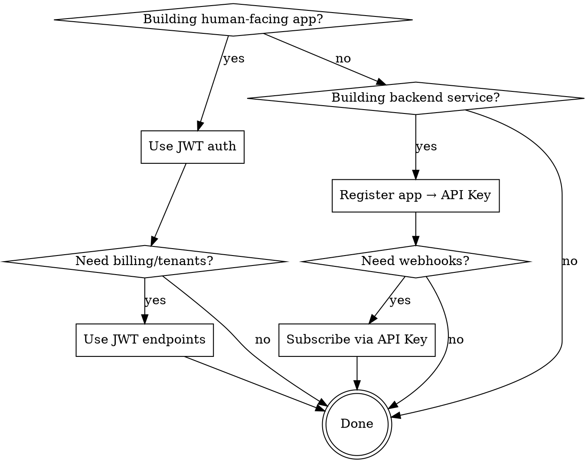

# Moonsbow Core Integration

## Overview

Moonsbow Core is a centralized SaaS toolkit providing authentication, billing, webhooks, notifications, and multi-tenancy to other applications. Every consumer registers as an `App` and receives an `API Key` for service-to-service auth. Human users authenticate via JWT.

**Core principle:** Dual auth mode — JWT for humans/dashboard, API Key for machines. Every business record is scoped to a `tenant_id`.

## When to Use

- Building a new service that needs Moonsbow auth, billing, or notifications
- Creating a client SDK or API wrapper for Moonsbow
- Setting up webhook receivers for platform events
- Integrating a third-party app with Moonsbow's tenant system
- Migrating an existing app to use Moonsbow for user management or subscriptions

## Quick Reference

| Task | Auth | Endpoint |
|------|------|----------|
| Login user | — | `POST /api/v1/auth/login` |
| Register user | — | `POST /api/v1/auth/register` |
| Get current user | JWT | `GET /api/v1/auth/me` |
| Register app | JWT | `POST /api/v1/apps/` |
| Rotate API key | JWT | `POST /api/v1/apps/{id}/rotate-key` |
| Subscribe to webhooks | API Key | `POST /api/v1/webhooks/` |
| Create tenant | JWT | `POST /api/v1/tenants/` |
| Create subscription | JWT | `POST /api/v1/billing/subscriptions` |
| Publish event | JWT | `POST /api/v1/events/` |
| Send notification | JWT | `POST /api/v1/notifications/` |

## Base URL and Versioning

- Prefix: `/api/v1`
- IDs: UUID v4 (strings in JSON)
- Timestamps: ISO 8601
- Pagination: `page` and `size` query params (default `page=1`, `size=20`)
- List responses: raw JSON array `[{}, {}]`

## Auth Modes

### JWT Bearer (Human Users)

```
POST /api/v1/auth/login     →  { access_token, token_type }
Authorization: Bearer <access_token>
```

- HS256, 30-minute expiry default
- Payload: `{ sub: "<user_id>" }`

### API Key (Service-to-Service)

```
POST /api/v1/apps/  (with JWT)  →  { api_key }
X-API-Key: <api_key>
```

- Auto-generated: `mb_<urlsafe_32>`
- Only the webhooks module requires this auth mode
- Rotate via `POST /api/v1/apps/{id}/rotate-key`

## Complete Client: TypeScript

```typescript
class MoonsbowClient {
  constructor(
    private baseUrl: string,
    private token?: string,
    private apiKey?: string
  ) {
    this.baseUrl = baseUrl.replace(/\/$/, "");
  }

  private headers(extra: Record<string, string> = {}): Record<string, string> {
    const h: Record<string, string> = { "Content-Type": "application/json", ...extra };
    if (this.token) h["Authorization"] = `Bearer ${this.token}`;
    if (this.apiKey) h["X-API-Key"] = this.apiKey;
    return h;
  }

  async request<T>(path: string, options: RequestInit = {}): Promise<T> {
    const res = await fetch(`${this.baseUrl}${path}`, {
      ...options,
      headers: this.headers(options.headers as Record<string, string>),
    });
    if (!res.ok) {
      const err = await res.json().catch(() => ({ detail: `HTTP ${res.status}` }));
      throw new Error(err.detail || `HTTP ${res.status}`);
    }
    if (res.status === 204) return undefined as T;
    return res.json() as Promise<T>;
  }

  // Auth
  login = (email: string, password: string) =>
    this.request<{ access_token: string; token_type: string }>("/api/v1/auth/login", {
      method: "POST",
      body: JSON.stringify({ email, password }),
    });

  me = () => this.request<UserResponse>("/api/v1/auth/me");

  // Apps
  createApp = (data: AppCreate) => this.request<AppResponse>("/api/v1/apps/", { method: "POST", body: JSON.stringify(data) });
  rotateKey = (id: string) => this.request<AppResponse>(`/api/v1/apps/${id}/rotate-key`, { method: "POST" });

  // Webhooks (API Key auth)
  createWebhook = (data: WebhookCreate) => this.request<WebhookResponse>("/api/v1/webhooks/", { method: "POST", body: JSON.stringify(data) });

  // Billing
  createSubscription = (data: SubscriptionCreate) =>
    this.request<SubscriptionResponse>("/api/v1/billing/subscriptions", { method: "POST", body: JSON.stringify(data) });

  // Tenants
  createTenant = (data: TenantCreate) => this.request<TenantResponse>("/api/v1/tenants/", { method: "POST", body: JSON.stringify(data) });
}
```

## Complete Client: Python

```python
import httpx
from typing import Any

class MoonsbowClient:
    def __init__(self, base_url: str, token: str | None = None, api_key: str | None = None):
        self.base_url = base_url.rstrip("/")
        self.token = token
        self.api_key = api_key

    def _headers(self, extra: dict[str, str] | None = None) -> dict[str, str]:
        h = {"Content-Type": "application/json", **(extra or {})}
        if self.token:
            h["Authorization"] = f"Bearer {self.token}"
        if self.api_key:
            h["X-API-Key"] = self.api_key
        return h

    async def request(self, method: str, path: str, **kwargs: Any) -> Any:
        async with httpx.AsyncClient() as client:
            res = await client.request(
                method,
                f"{self.base_url}{path}",
                headers={**self._headers(), **kwargs.pop("headers", {})},
                **kwargs,
            )
            res.raise_for_status()
            if res.status_code == 204:
                return None
            return res.json()

    # Auth
    async def login(self, email: str, password: str) -> dict:
        return await self.request("POST", "/api/v1/auth/login", json={"email": email, "password": password})

    async def me(self) -> dict:
        return await self.request("GET", "/api/v1/auth/me")

    # Apps
    async def create_app(self, data: dict) -> dict:
        return await self.request("POST", "/api/v1/apps/", json=data)

    async def rotate_key(self, app_id: str) -> dict:
        return await self.request("POST", f"/api/v1/apps/{app_id}/rotate-key")

    # Webhooks (API Key auth)
    async def create_webhook(self, data: dict) -> dict:
        return await self.request("POST", "/api/v1/webhooks/", json=data)

    # Billing
    async def create_subscription(self, data: dict) -> dict:
        return await self.request("POST", "/api/v1/billing/subscriptions", json=data)

    # Tenants
    async def create_tenant(self, data: dict) -> dict:
        return await self.request("POST", "/api/v1/tenants/", json=data)
```

## Webhook Verification

Moonsbow signs every webhook payload with `HMAC-SHA256`. Verify before processing.

### TypeScript

```typescript
import { createHmac } from "crypto";

function verifyWebhook(payload: string, signature: string, secret: string): boolean {
  const expected = createHmac("sha256", secret).update(payload).digest("hex");
  return expected === signature.replace("sha256=", "");
}
```

### Python

```python
import hmac
import hashlib

def verify_webhook(payload: bytes, signature: str, secret: str) -> bool:
    expected = hmac.new(secret.encode(), payload, hashlib.sha256).hexdigest()
    return hmac.compare_digest(expected, signature.removeprefix("sha256="))
```

**Webhook payload structure:**

```json
{
  "event_id": "<uuid>",
  "event_type": "user.created",
  "timestamp": "2024-01-15T10:30:00+00:00",
  "app_id": "<uuid>",
  "data": { }
}
```

**Rules for webhook handlers:**
1. Always verify `X-Webhook-Signature` before processing
2. Return `200 OK` immediately; process asynchronously
3. Deduplicate using `event_id`
4. Common events: `user.created`, `subscription.updated`, `subscription.cancelled`

## Integration Flowchart



## Error Handling

| Status | Meaning | Action |
|--------|---------|--------|
| `401` | Token expired or API Key invalid | Re-authenticate or check key |
| `403` | App inactive or insufficient permissions | Check app status / user roles |
| `409` | Duplicate (email, slug) | Show validation error to user |
| `422` | Invalid field format | Display per-field errors |
| `404` | Resource not found | Verify UUID exists |

## Module Index

| Module | Purpose | Auth | File |
|--------|---------|------|------|
| auth | Users, login, JWT | Public / JWT | [auth.md](./auth.md) |
| apps | App registration, API keys | JWT | [apps.md](./apps.md) |
| webhooks | Event subscriptions, HMAC verification | API Key | [webhooks.md](./webhooks.md) |
| billing | Subscriptions, plans | JWT | [billing.md](./billing.md) |
| tenants | Organizations, multi-tenancy | JWT | [tenants.md](./tenants.md) |
| events | Platform event log | JWT | [events.md](./events.md) |
| notifications | User notifications | JWT | [notifications.md](./notifications.md) |
| patterns | Common integration patterns | — | [INTEGRATION_PATTERNS.md](./INTEGRATION_PATTERNS.md) |

## Multi-Tenancy Rules

- Every business table has `tenant_id`
- Tenant isolation is at the application layer
- JWT tokens contain only `sub` (user_id); tenant resolution happens in services
- When creating resources (events, notifications, subscriptions), always include `tenant_id`

## Source of Truth

<!-- Last synced with backend: 2026-06-03 -->
<!-- Source files: backend/api/router.py, backend/modules/*/router.py, backend/modules/*/schemas.py, backend/core/security/*.py -->
